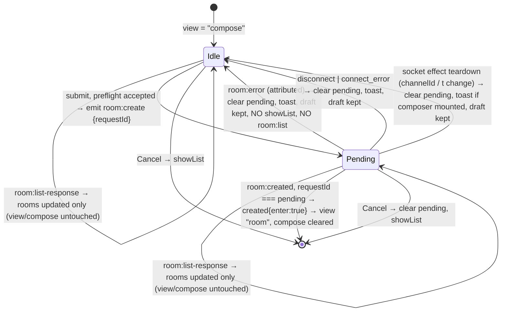

## Context

In DeskRPG, room creation takes place inside `RoomComposer.tsx` rendered within the `ChatPanel` overlay on `GamePageClient.tsx`.
During meeting `ad31ede2-30af-4237-874d-3f32da441cc1`, team members investigated reports that users cannot create new rooms and perceive the "Create" button as dead.
The investigation revealed that:
1. `RoomComposer.tsx` enforces `needNpc = mode === "create" && npcIds.size === 0`. If a user inputs a room name and selects human colleagues (`userIds`), but does not check an AI agent profile (`npcIds`), the button is disabled. However, the only error indicator (`room.needNpc`) is located high up in the Staff section, out of the user's immediate visual attention when looking at the bottom action button.
2. In `GamePageClient.tsx`, `handleRoomCreate` silently returns without any feedback if `!socket || !socket.connected || !channelId`. If network connectivity is lost or channel context is absent, the user is left with no explanation.

Reviewer v1 (`reviews/findings-reviewer-v1.md`, C-01/W-01) added a third, structural finding against the first revision of this design:

3. `ChatPanel.tsx:1016-1019` dispatches `showList` immediately after invoking the void `onRoomCreate(...)` callback. `showList` sets `view: "list", compose: undefined` (`room-state.ts:208-210`), which unmounts `RoomComposer` and destroys the entered name and selections **before** the request has been accepted, let alone acknowledged. Any preflight rejection, `room:error`, or socket drop therefore abandons the user's input even if a toast is shown. The authoritative entry path already exists: `GamePageClient.tsx:833-836` matches the `room:created` ticket against `pendingCreateRef` and `room-state.ts:186-187` enters the room (and clears `compose`) only when `enter` is true. The immediate `showList` is premature and unnecessary.

Reviewer v2 (`reviews/findings-reviewer-v2.md`, C-02/W-02/W-03) found two remaining asynchronous exits from the compose view that the v2 lifecycle did not guard:

4. **C-02 — `room:list-response` re-enters the list reducer.** The `list` reducer action unconditionally sets `view: currentRoomId ? "room" : "list"` and `compose: undefined` (`room-state.ts:89-103`). `room:list` is emitted on `connect`, `players:state`, socket initialization, and (in v2 of this design) optionally after an attributed create `room:error` (`GamePageClient.tsx:695-702,758-762,1222-1225,740`). Any of those responses arriving while `view === "compose"` unmounts `RoomComposer` and destroys the locally held draft — the same abandoned-input class as C-01, reached through a different reducer action.
5. **W-02 — socket-effect teardown bypasses the `disconnect` handler.** The effect cleanup calls `removeAllListeners()` before `disconnect()` (`GamePageClient.tsx:1228-1258`, see its own comment), and the effect is recreated whenever `channelId` or `t` changes (`:1260`) while the page stays mounted. A create pending at teardown would survive into the replacement socket as an unreachable ticket that keeps the composer busy and rejects new submissions.

This design defines the technical architecture for (a) colocated validation feedback and (b) a single, acknowledgment-driven room creation lifecycle across `RoomComposer` → `ChatPanel` → `GamePageClient`, including the list-refresh guard (Decision 8) and the connection-context replacement cleanup (Decision 9).

## Goals / Non-Goals

**Goals:**
- Provide immediate, contextual feedback positioned directly beneath or adjacent to the primary action button in `RoomComposer`.
- Ensure users instantly understand why the button is disabled (e.g., "Select at least one AI agent to create a room").
- Dynamically enable the button and clear the helper message the moment the user checks an AI agent profile.
- Eliminate silent bailouts in `GamePageClient.tsx` by introducing user-visible notifications when socket or channel context is unavailable.
- Keep the composer mounted — and the draft (name, `npcIds`, `userIds`) intact — from submit until a **matching** `room:created` acknowledgment; every failure path (preflight rejection, `room:error`, `disconnect`/`connect_error`) returns the composer to a retryable idle state.
- Guarantee at most one in-flight `room:create` per composer session (explicit duplicate-submit policy) and that no stale pending state survives a failure or a replacement of the socket/channel context.
- Guarantee that while `view === "compose"`, no `room:list-response` — whether triggered by connect, `players:state`, socket initialization, or an error refresh — can change `view`, clear `compose`, or unmount `RoomComposer` (C-02).
- Maintain full localization support across English (`en`), Korean (`ko`), Japanese (`ja`), and Chinese (`zh`).

**Non-Goals:**
- Allowing room creation without any AI agents: DeskRPG's game loop fundamentally relies on NPC presence in chat rooms.
- Modifying the underlying SQLite schema or database models.
- Altering the server-side `room:create` / `room:created` / `room:error` WebSocket wire protocol. The server already echoes the request ticket only to the creator (`room-socket.ts:342-370`) and emits `room:error` as `{ roomId, code }` (`room-socket.ts:160-162`); this change consumes both as-is.
- Introducing a client-side acknowledgment timeout. A silent server is surfaced by the existing `SocketConnectionNotice` and resolved by the `disconnect` cleanup path or by the user pressing Cancel; a timer is deferred to a follow-up change if field data shows it is needed.

## Decisions

### Decision 1: Colocate validation helper message directly under the action button
- **Rationale**: When users interact with a form, their visual focus during submission is on the primary action button ("Create"). Placing the explanatory warning message directly beneath the button eliminates the cognitive friction of scanning back up through the form.
- **Alternatives Considered**:
  - *Alternative A: Keep button enabled and show a toast on click.* Rejected because disabling invalid submission prevents unnecessary submit attempts, while inline helper feedback guides the user before clicking.
  - *Alternative B: Only keep in-section warning.* Rejected because empirical evidence from meeting `ad31ede2-30af-4237-874d-3f32da441cc1` proved users overlook the message at the top of the modal.

### Decision 2: Maintain in-section warning as secondary reinforcement
- **Rationale**: Retaining the warning inside the Staff section preserves context when the user is actively browsing staff candidates, while the button-adjacent helper acts as the primary submission gate.
- **Alternatives Considered**: Removing the in-section warning entirely. Rejected because having both ensures visibility regardless of scroll position.

### Decision 3: One acknowledgment-driven create lifecycle owned by `GamePageClient` (resolves C-01)

The create lifecycle has exactly one owner — `GamePageClient` — and exactly one way to leave the compose view on success: the existing `created` reducer action with `enter: true`.

**Contract changes (client-only, no wire change):**

| Layer | Before | After |
| --- | --- | --- |
| `ChatPanelProps.onRoomCreate` | `(name, npcIds, userIds) => void` | `(name, npcIds, userIds) => RoomCreateDispatch` |
| `ChatPanel` compose `onSubmit` (create branch) | calls `onRoomCreate` then dispatches `showList` | calls `onRoomCreate` only; dispatches **nothing**; `roomState.view` stays `"compose"` and `RoomComposer` stays mounted with its local draft |
| `ChatPanelProps` (new) | — | `roomCreatePending: boolean`, `roomCreateAvailability: { connected: boolean; hasChannel: boolean }` (both forwarded to `RoomComposer`) |
| `RoomComposerProps` (new, optional) | — | `pending?: boolean`, `availability?: { connected: boolean; hasChannel: boolean }` |
| `GamePageClient` pending state | `pendingCreateRef: MutableRefObject<string \| null>` (ref only) | ref **plus** mirrored React state `pendingCreate: { requestId: string } \| null`, always written together through a single `setPendingCreate(next)` helper so socket handlers (ref) and render (state) never disagree |

`RoomCreateDispatch` is a discriminated union defined in a small pure module (suggested: `src/app/game/room-create-dispatch.ts`, colocated with `chat-error-dispatch.ts`):

```ts
type RoomCreateDispatch =
  | { accepted: true; requestId: string }
  | { accepted: false; reason: "disconnected" | "missing_channel" | "pending" };
```

The preflight decision and the `room:error` attribution (Decision 5) are pure functions in that module so `node:test` can cover them without React or a socket.

**Lifecycle (normative):**



```mermaid
sequenceDiagram
    participant RC as RoomComposer
    participant CP as ChatPanel
    participant GP as GamePageClient
    participant S as Socket / Server

    RC->>CP: onSubmit({name, npcIds, userIds})
    CP->>GP: onRoomCreate(name, npcIds, userIds)
    alt !socket || !socket.connected
        GP-->>CP: {accepted:false, reason:"disconnected"} + toast room.create.offline
    else !channelId
        GP-->>CP: {accepted:false, reason:"missing_channel"} + toast room.create.noChannel
    else pendingCreate !== null
        GP-->>CP: {accepted:false, reason:"pending"} (no emit, no toast)
    else
        GP->>GP: requestId = randomUUID(); setPendingCreate({requestId})
        GP->>S: emit room:create {channelId, name, npcIds, userIds, requestId}
        GP-->>CP: {accepted:true, requestId}
    end
    Note over CP,RC: ChatPanel dispatches nothing. view stays "compose". RoomComposer keeps its draft; pending prop disables submit.
    alt room:created with requestId === pending
        S-->>GP: room:created {room, requestId}
        GP->>GP: setPendingCreate(null); dispatchRoom(created, enter:true)
        Note over RC: unmounted by reducer (view="room")
    else room:created with other/no requestId
        S-->>GP: room:created {room}
        GP->>GP: dispatchRoom(created, enter:false)
    else room:error while pending
        S-->>GP: room:error {roomId, code}
        GP->>GP: setPendingCreate(null); toast; NO showList
        Note over RC: still mounted, draft intact, submit re-enabled
    else disconnect / connect_error while pending
        S-->>GP: disconnect
        GP->>GP: setPendingCreate(null); toast room.create.interrupted
    end
```

- **Rationale**: The ticket-matching path and the `created.enter` reducer branch already exist and are tested at the reducer level; the only defect is that `ChatPanel` races ahead of them. Making `GamePageClient` the sole owner of pending state removes the race, keeps `RoomComposer` free of socket knowledge, and keeps the reducer pure.
- **Alternatives Considered**:
  - *Snapshot the draft in `ChatPanel`/reducer state and re-hydrate the composer after failure.* Rejected: it duplicates state the composer already holds, requires a new reducer action, and still unmounts/remounts the composer (focus loss, scroll reset).
  - *Return a `Promise` from `onRoomCreate` resolved on `room:created`.* Rejected: a promise that may never settle (silent server, drop) needs the same cleanup paths anyway and hides pending state from render.
  - *Keep the immediate `showList` and show the created room via the list.* Rejected: directly violates the delta spec's "dismiss only on matching `room:created`" requirement and still abandons the draft on failure.

### Decision 4: Duplicate-submit policy — single in-flight request, UI-gated and callback-gated
- **Policy**: While `pendingCreate !== null`, the `RoomComposer` submit button is `disabled` + `aria-disabled="true"` + `aria-busy="true"` and shows the localized `room.create.pending` label; the `Cancel` button stays enabled. As a second line of defense, `handleRoomCreate` rejects any call made while pending with `{ accepted: false, reason: "pending" }` and emits nothing. No queueing, no coalescing, no second ticket.
- **Precedence over validation readiness (QA v1 W-03)**: the `pending` gate takes precedence over the composer's selection-based readiness (`canSubmit`). Selecting an AI agent enables submit **only while idle** (`pending === false`); while `pending === true` the submit button stays `disabled` + `aria-disabled="true"` + `aria-busy="true"` no matter how the selections change, and clicking it never calls `onSubmit`. The reactive helper text (Decision 1, task 2.5) is evaluated independently of `pending`: it clears/appears purely from `npcIds`/`userIds`, so during pending the helper reflects the current validity of the draft even though the button is held busy. Selection changes while pending do not touch `pendingCreate` and dispatch nothing.
- **Rationale**: The server creates one room per `room:create`; an uncontrolled double submit would create two rooms, only one of which the client would enter. Gating in both the view and the callback makes the behavior deterministic regardless of how the submit is triggered (click, Enter key, test harness).
- **Alternatives Considered**: *Allow resubmit and replace the ticket.* Rejected because the first request may still succeed server-side, producing an orphan room. *Freeze the selection controls while pending.* Rejected: it adds a third disabled state the user must interpret, and the single in-flight guard already makes selection edits harmless (they only affect the next idle submit).

### Decision 5: Failure and cleanup paths — pending state never outlives the request (resolves C-01 items 3–4)

| Trigger | Condition | Action | Composer / draft |
| --- | --- | --- | --- |
| Preflight — disconnected | `!socket \|\| !socket.connected` | return `disconnected`; toast `room.create.offline`; no emit; pending unchanged (still `null`) | kept, submit stays enabled |
| Preflight — no channel | `!channelId` | return `missing_channel`; toast `room.create.noChannel`; no emit | kept, submit stays enabled |
| Preflight — pending | `pendingCreate !== null` | return `pending`; no emit; no toast (button is already busy) | kept |
| `room:created` matching | `data.requestId === pending.requestId` | `setPendingCreate(null)`; `dispatchRoom({type:"created", enter:true})` | composer dismissed by reducer; this is the **only** success exit |
| `room:created` nonmatching | `requestId` absent or different | `dispatchRoom({type:"created", enter:false})`; pending unchanged | kept |
| `room:error` while pending | `pendingCreate !== null` (see attribution rule) | `setPendingCreate(null)`; toast `room.create.failed` (or the existing `game.room.error.<code>` text); **MUST NOT** dispatch `showList`; **MUST NOT** emit `room:list` (Decision 8 — the refresh is unnecessary because no room was created, and a list response would exit compose) | kept, submit re-enabled; one retry generates a **new** `requestId` |
| `disconnect` / `connect_error` while pending | event fires with `pendingCreate !== null` | `setPendingCreate(null)`; toast `room.create.interrupted`; `SocketConnectionNotice` continues to show the outage | kept, submit re-enabled; user retries after reconnect (a retry while still offline hits the preflight path) |
| Socket effect teardown while pending (Decision 9) | effect cleanup runs with `pendingCreateRef.current !== null` (`channelId`/`t` change, or unmount) | `setPendingCreate(null)` **inside the cleanup**, after `removeAllListeners()` so no handler races it; toast `room.create.interrupted` only if the component is still mounted (`cancelled` flag / channel change, not unmount) | kept if still mounted, submit re-enabled on the replacement socket; a late `room:created` for the old ticket is nonmatching |
| `room:list-response` while `view === "compose"` (Decision 8) | any trigger (connect, `players:state`, init, or stale) | `dispatchRoom({type:"list", ...})` — the reducer updates `rooms`/`viewerUserId` and recomputes `currentRoomId`, but **MUST NOT** change `view` or `compose` while `state.view === "compose"` | kept, pending unchanged |
| Cancel while pending | user clicks Cancel | `setPendingCreate(null)`; `dispatchRoom({type:"showList"})` | discarded by explicit user choice; a late matching `room:created` no longer matches (ref is `null`) and only updates the list |
| Retry after failure | user submits again from idle | normal preflight; new `crypto.randomUUID()` ticket | a late `room:created` for the **old** ticket is nonmatching and does not enter |

**`room:error` attribution rule**: while a create is pending, every incoming `room:error` is attributed to the pending create. Justification: the composer is a full-panel view (`view === "compose"`), so the client cannot issue `room:open`/`room:send`/`room:invite`/`room:leave`/`room:rename`/`room:delete` concurrently, and the reconnect-driven `room:list` is only emitted after `disconnect` has already cleared pending. The server's create path fails with `roomId: null` for `invalid`/`forbidden` and `roomId: <id>` for `not_found` (`room-socket.ts:349-366`); both are covered by the rule. The attribution decision is exposed as a pure function (`decideCreateError(payload, pending)`-style) so the existing `decideChatError` behavior for non-pending states is unchanged and separately tested. The attributed branch returns `backToList: false` and `refreshList: false`; the `room:list` refresh that the generic `forbidden`/`not_found` branch performs is **not** carried over, because the create did not produce a room and a list refresh would re-enter the `list` reducer (Decision 8).

- **Rationale**: Reviewer C-01 identified that the generic `room:error` handler (`GamePageClient.tsx:733-740`) navigates to the list on `forbidden`/`not_found`. Without the attribution guard, a server-side create rejection would both toast and destroy the draft.
- **Alternatives Considered**: *Correlate `room:error` by `requestId`.* Rejected: requires a server wire change (`room:error` carries no ticket), which is a stated non-goal.

### Decision 6: Availability is surfaced on attempt, with a passive hint while composing
- **Behavior**: `roomCreateAvailability` is derived in `GamePageClient` from `socketConnected` and `channelId` and forwarded to `RoomComposer`. While `!connected` or `!hasChannel`, the composer renders a non-blocking footer hint (`room.create.offline` / `room.create.noChannel` text) but the submit button is **not** disabled by availability alone, because reconnection is transient and the authoritative check is the preflight at submit time. The preflight toast is the guaranteed feedback; the hint is reinforcement.
- **Rationale**: Replacing the silent `return` in `GamePageClient.tsx:1751` with a returned reason + toast guarantees the spec's "never silently discard" requirement; the passive hint lowers the chance of a doomed click without introducing a second, possibly stale, gate.
- **Alternatives Considered**: *Disable the composer when disconnected.* Rejected: a stale `connected=false` during a quick reconnect would block a submit that the preflight would have accepted.

### Decision 7: Accessible and high-contrast disabled state
- **Rationale**: The button must clearly communicate disabled state via `aria-disabled="true"`, explicit CSS cursor (`cursor-not-allowed`), and opacity/color contrast that is unmistakably inactive. The pending state additionally sets `aria-busy="true"` and swaps the label so a screen reader distinguishes "cannot submit yet" from "submitting".

### Decision 8: The `list` reducer action never exits an active compose view (resolves Reviewer v2 C-02)

**Policy (two layers, both mandatory):**

1. **Reducer guard (authoritative).** `reduceRoomState` `case "list"` becomes compose-preserving: when `state.view === "compose"`, it updates `rooms`, `viewerUserId`, and `currentRoomId` (the same values it computes today) but returns `view: "compose"` and the existing `compose` object unchanged. In every other view the current behavior (`view: currentRoomId ? "room" : "list"`, `compose: undefined`) is preserved verbatim. The reducer remains pure; no new action type is introduced.
2. **Emission guard (defense in depth).** The attributed create-error path (Decision 5) **MUST NOT** emit `room:list`. The remaining `room:list` emitters (`connect`, `players:state`, socket initialization — `GamePageClient.tsx:695-702,758-762,1222-1225`) are left untouched; the reducer guard makes their responses safe while composing.

**Resulting matrix for `room:list-response` while `view === "compose"`:**

| State | `rooms` | `currentRoomId` | `view` | `compose` | `pendingCreate` | `RoomComposer` |
| --- | --- | --- | --- | --- | --- | --- |
| Idle (draft entered) | updated | recomputed | `"compose"` | unchanged | `null` | mounted, draft intact |
| Pending | updated | recomputed | `"compose"` | unchanged | unchanged | mounted, draft intact, busy |

`currentRoomId` is still recomputed so that a later `showList`/`open` or a matching `room:created` behaves exactly as before; nothing reads `currentRoomId` while `view === "compose"` (`ChatPanel.tsx:1004-1023` branches on `view` first).

- **Rationale**: Reviewer v2 C-02 proved that every `room:list` emitter is asynchronous relative to the compose view; guarding only the emitters this change controls would leave `connect`/`players:state` responses able to unmount the composer after a reconnect. The reducer is the single choke point through which all list responses pass and is already covered by `node:test`, so the guard is both complete and cheap to prove.
- **Alternatives Considered**:
  - *Guard only emission (drop `room:list` from the error path, leave the reducer as-is).* Rejected: does not cover the `connect`/`players:state`/init emitters that fire on reconnect while composing.
  - *Filter `room:list-response` in the socket handler using a `roomState.view` ref.* Rejected: requires mirroring reducer state into a ref inside the socket effect and silently drops server data (`rooms`, `viewerUserId`) that the list view needs once the user cancels.
  - *Snapshot/restore the draft around the list reduction.* Rejected for the same reasons as in Decision 3 (duplicated state, unmount/remount).

### Decision 9: Pending state is cleared in the socket-effect cleanup (resolves Reviewer v2 W-02)

**Policy:** the socket effect cleanup (`GamePageClient.tsx:1228-1259`) gains one step, placed after `socketInstance.removeAllListeners()` / `disconnect()` and before `setSocket(null)`:

```text
if (pendingCreateRef.current !== null) {
  setPendingCreate(null);                                  // ref + state together (Decision 3 helper)
  if (!unmounting) showToastNotification("room-create-interrupted", t("room.create.interrupted"));
}
```

- The cleanup runs on `channelId`/`t` change **and** on unmount. The helper writes the ref synchronously and the state through React; on unmount the state write is a no-op and harmless.
- **User feedback**: when the component stays mounted (channel-context replacement), the composer — still mounted with its draft under Decision 8 — receives the same `room.create.interrupted` toast as the `disconnect` path, and its submit is re-enabled on the replacement socket. On unmount no toast is shown (there is no UI to show it on). The Coder distinguishes the two by the existing `cancelled` flag pattern or a dedicated `unmountingRef` set from a separate `useEffect(() => () => { unmountingRef.current = true }, [])`; the choice is an implementation detail, but the observable behavior (toast on replacement, no toast on unmount) is normative.
- **Invariant**: after cleanup, `pendingCreateRef.current === null` and `pendingCreate === null` before the replacement socket can connect, so the first submit on the new socket passes the `pending` preflight and generates a fresh ticket. A late `room:created` for the old ticket arriving on the new socket is nonmatching (Decision 5).

- **Rationale**: Reviewer v2 W-02 — the cleanup detaches the `disconnect` handler before disconnecting (`GamePageClient.tsx:1252` comment), so Task 3.6's `disconnect` branch never runs on effect teardown; the pending ticket would survive into the new socket and keep the composer busy with no way out except Cancel.
- **Alternatives Considered**:
  - *Reorder cleanup to `disconnect()` before `removeAllListeners()` so the `disconnect` handler fires.* Rejected: changes the teardown ordering for every other handler in that block (NPC streaming, report calls, `openedRoomRef`) and would fire React state updates from a socket callback during cleanup; an explicit, scoped cleanup step is safer.
  - *Key pending state by socket instance and ignore mismatches.* Rejected: still leaves the UI busy until something clears it.

## Risks / Trade-offs

- **[Risk] Layout shifting in modal footer when helper text appears/disappears**
  - **Mitigation**: Reserve a dedicated min-height container for the helper text beneath the button or use smooth CSS transitions, preventing awkward modal resizing.
- **[Risk] Long localized strings in different languages (e.g., Korean/Japanese/English)**
  - **Mitigation**: Allow text wrapping within the footer container with `text-xs text-danger text-center` styling.
- **[Risk] Ephemeral socket reconnects causing false alarms**
  - **Mitigation**: Toast only on an actual submit attempt (preflight) or an actual drop while pending; the passive hint is informational and never blocks.
- **[Risk] Server never answers a `room:create` (no ack, no error, no drop)**
  - **Mitigation**: Accepted for this change (no timeout, see Non-Goals). The user can Cancel, which clears pending; a later matching ack is harmless (list-only update).
- **[Risk] A `room:error` from an unrelated source arriving while pending is misattributed**
  - **Mitigation**: Attribution is scoped to `view === "compose"` + pending; the only consequence of a false positive is a spurious "retry" toast with the draft intact — strictly safer than the current behavior.
- **[Risk] Ref/state divergence for pending**
  - **Mitigation**: Single `setPendingCreate` helper writes both; a unit test asserts the ref and state are equal after every transition, including after socket-effect cleanup (Decision 9).
- **[Risk] A reconnect-driven `room:list-response` lands while the user is composing**
  - **Mitigation**: Decision 8 reducer guard — `rooms` are refreshed, `view`/`compose` untouched; covered by reducer tests (tasks 5.14–5.16) and lifecycle tests (5.17–5.18).
- **[Risk] Changing the `list` reducer alters list-view behavior for non-compose states**
  - **Mitigation**: The guard is conditioned strictly on `state.view === "compose"`; the existing `room-state.test.ts` cases for `list` in `list`/`room` views are kept unchanged as the regression gate (task 5.16).

## Migration Plan

1. Add `src/app/game/room-create-dispatch.ts` (pure preflight + error attribution + types) with `node:test` coverage.
2. Update `src/app/game/room-state.ts`: make the `list` reducer action compose-preserving (Decision 8) with `node:test` coverage in `room-state.test.ts`.
3. Update `src/app/game/GamePageClient.tsx`: `pendingCreate` state mirrored with `pendingCreateRef`; `handleRoomCreate` returns `RoomCreateDispatch` and toasts on rejection; `room:created`, `room:error` (no `room:list` emission), `disconnect`, `connect_error` handlers apply Decision 5; socket-effect cleanup clears pending and toasts when still mounted (Decision 9); forward `roomCreatePending` and `roomCreateAvailability` to `ChatPanel`.
4. Update `src/components/ChatPanel.tsx`: change `onRoomCreate` type; remove the `showList` dispatch in the create branch of the compose `onSubmit`; forward `pending`/`availability` to `RoomComposer`; clear pending on Cancel via `onRoomAction` consumer (GamePageClient wraps `handleRoomAction` to clear pending when `action.type === "showList"` while pending).
5. Update `src/components/rooms/RoomComposer.tsx`: colocated helper, `aria-disabled`, pending/busy state, availability hint.
6. Add localization keys in `src/lib/i18n/locales/{en,ko,ja,zh}.ts`.
7. Verify with the tests in `tasks.md` §4 and §5.

## Open Questions

- None. The lifecycle decisions above (Decisions 3–6, 8, 9) are fixed by this design so the Coder does not have to choose them; the original UX approach was agreed in meeting `ad31ede2-30af-4237-874d-3f32da441cc1`.

## Architecture Updates

### Landing decision (Leader, QA v1 W-01)

- **Current state (verified 2026-10-02)**: `O:/workspaces/oss/deskrpg` has **no** `docs/` directory and **no** root `ARCHITECTURE.md` (`ls docs ARCHITECTURE.md` → both "No such file or directory"). There is no project-level architecture document to produce an ADDED/MODIFIED delta against.
- **Leader decision**: an explicit **no-global-document exception** is approved for `room-creation-availability-and-validation-feedback`. No global architecture document is created during the Propose phase. This `design.md` (Decisions 3–9) is the **authoritative** record of the architectural contracts below until documentation is formalized.
- **Future landing target**: when the repository formalizes architecture documentation, the contracts in this section are to be merged (delta → main, during post-archive, with Human review) into `docs/architecture/client-lifecycle.md`, or into root `ARCHITECTURE.md` if the project adopts a single-file layout. The target does not exist today; nothing below implies it does.
- **Sync timing**: per the collaboration protocol, architecture sync happens at post-archive, not at archive. The Leader owns the merge; the Designer owns this delta.

### Delta for the future target — all entries are ADDED (no existing document to MODIFY)

| # | Section to land | Contract (normative summary) | Source |
| --- | --- | --- | --- |
| A1 | Client room-create lifecycle | `GamePageClient` is the **single owner** of the create lifecycle. States: `Idle` → `Pending` → exit only via `created{enter:true}` on a `room:created` whose `requestId` matches the pending ticket. Every failure (preflight rejection, attributed `room:error`, `disconnect`/`connect_error`, socket-effect teardown) returns to `Idle` with the draft retained; Cancel exits via `showList`. Exactly one `room:create` may be in flight (`pendingCreateRef` + mirrored `pendingCreate` state written only through `setPendingCreate`). | Decisions 3, 4, 5, 9; state diagram in Decision 3 |
| A2 | Component contract boundary | `RoomComposer` holds the draft (`name`, `npcIds`, `userIds`) and is socket-agnostic; it receives `pending` and `availability` as props. `ChatPanel` forwards `onRoomCreate` (now returning `RoomCreateDispatch`) and dispatches **nothing** after a create submit. Pure decision logic lives in `src/app/game/room-create-dispatch.ts` (`decideRoomCreate`, `decideCreateError`), colocated with `chat-error-dispatch.ts`. | Decision 3 contract table; Migration Plan steps 1, 3–5 |
| A3 | Socket ↔ reducer coordination | The `room-state` reducer is the single choke point for every `room:list-response`; its `list` action is **compose-preserving** (`view`/`compose` untouched while `state.view === "compose"`, verbatim behavior elsewhere). Socket handlers never navigate the compose view directly; they only dispatch reducer actions or write pending state. The socket-effect cleanup clears pending state after `removeAllListeners()`/`disconnect()` and before `setSocket(null)`, so no ticket survives a connection-context replacement. | Decisions 8, 9 |
| A4 | Error attribution | While a create is pending and `view === "compose"`, every `room:error` is attributed to the pending create: clear pending, toast, **no** `showList`, **no** `room:list` emission. When not pending, the existing `decideChatError` behavior is unchanged. `room:error` carries no ticket by design (wire protocol unchanged, server `room-socket.ts:328-370`). | Decision 5 attribution rule; Decision 8 emission guard |
| A5 | Availability feedback | Readiness = `socket.connected && channelId && !pending`. Availability (`connected`, `hasChannel`) is derived in `GamePageClient` and forwarded to the composer as a passive hint; the authoritative check is the submit-time preflight, which always surfaces a toast instead of a silent return. | Decision 6 |
| A6 | Composer validation feedback | Helper text is colocated under the submit button and evaluated reactively from the selection state, independently of the pending gate; the disabled state is accessible (`disabled`, `aria-disabled`, `aria-busy` while pending, `cursor-not-allowed`/opacity styling). | Decisions 1, 2, 4 (precedence note), 7 |

### Out of scope for the architecture delta

- Server wire protocol (`room:create` / `room:created` / `room:error`), SQLite schema, and database models are unchanged (see Non-Goals). No server-side architecture section is affected.
